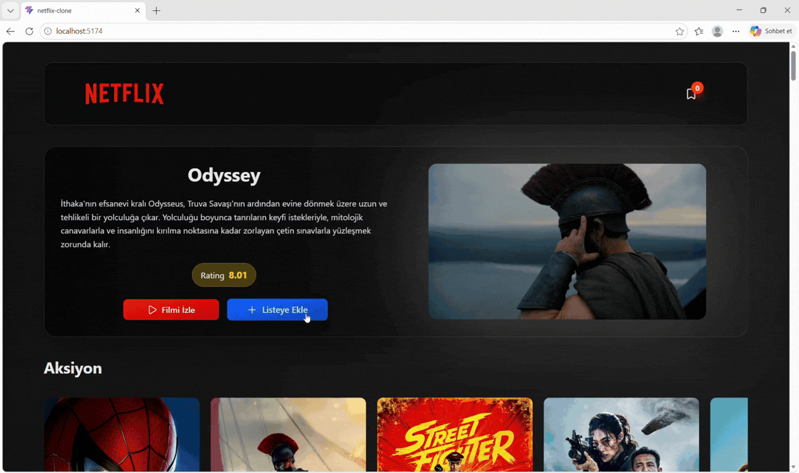

# Netflix Clone – React Application

A modern and responsive **Netflix Clone Web Application** built with React. The application allows users to explore popular movies and TV shows, view detailed movie information, and create their own watchlists using data from the TMDB API.

## 📌 Features

- Browse popular movies and TV shows
- View detailed movie information
- Create and manage personal watchlists
- Fetch dynamic movie data from the TMDB API
- Navigate between pages with dynamic routing
- Manage application state using Redux
- Responsive and user-friendly interface

## 🛠 Technologies Used

- **React 19** – Component-based UI development
- **Vite** – Fast development and build tool
- **Tailwind CSS 4** – Modern UI styling
- **React Router DOM** – Page routing and navigation
- **Redux** – State management
- **Axios** – API requests
- **CSS3** – Custom styling
- **TMDB API** – Movie and TV show data
- **Lucide React** – Interface icons

## 🎯 Project Purpose

This project was developed to practice React, component-based architecture, state management, API integration, and dynamic routing while building a movie streaming interface inspired by Netflix.

## Preview

